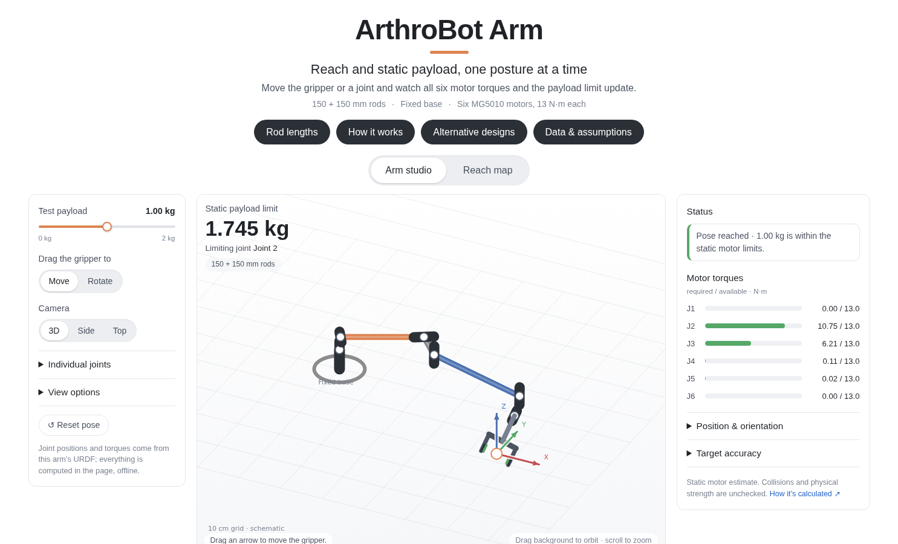

# Arm payload calculator

A static payload calculator for the ArthroBot arm (six MG5010 modules, 13 N·m each).
For any posture it answers: **how much can the gripper hold here, and which motor
gives out first?** It is a single offline web page, computed from the same arm model
as the rest of the repository. Code: `tools/arm_payload/`.



## Why we need it

- **Lifting is the arm's real limit, not reach.** Gravity torque on the shoulder and
  elbow motors decides what the arm can hold, and it changes with every posture. The
  stock arm holds **1.745 kg** with all joints at zero, but only **0.487 kg** in the
  most demanding stretched posture found. Joint 2 (shoulder pitch) sets the limit in
  both.
- **It answers design questions before hardware.** Rod lengths, motor choice, mounting
  height and gripper position can be compared in seconds. For example, the original
  joint chain reaches at most **0.722 m** from joint 1, so no payload makes it cover a
  1 m cube. The rod-length and redesign studies show what would.
- **It sizes the next step.** The arm is meant to carry modules and assemble robots
  (see the [README](../README.md)); this tool shows where it can hold a given module.
- **It is fast and shareable.** No simulator, no install: the page opens in any
  browser and works offline. Python is needed only to rebuild it.

## Open it

```bash
python tools/arm_payload/build_payload_viewer.py    # a few seconds; builds the arm model if needed
xdg-open tools/arm_payload/workspace_payload/payload_workspace.html
```

The build writes the page, the alternative-design page, the two map CSVs and the
printable chart into `tools/arm_payload/workspace_payload/` (git-ignored). Any
Python with NumPy, SciPy, trimesh and Matplotlib and the ArthroBot packages works,
for example the Isaac Lab environment of the [install](../README.md#install).

## What the page shows

- **Arm studio.** Drag the gripper (arrows move it, rings rotate it) or turn a joint;
  inverse kinematics keeps the grasp point on the target. The middle shows the static
  payload limit and the limiting joint for the displayed posture, the right column the
  six motor torques at the test payload. A target the local solver cannot reach gets
  no rating.
- **Reach map.** 67,108,864 sampled joint postures (half rejected by a self-collision
  screen), grouped into 2.5 cm cells. Each cell keeps its best posture, so the map
  shows where the gripper can hold 0, 0.5, 1, 1.5 or 2 kg, with the gripper at any
  angle or pointing down within 15°. Click a point to inspect its posture and torques.
- **Rod lengths.** Change the two carbon rods (50–750 mm): rod mass, the parts beyond
  each rod and the joint positions move with the length, and the page recomputes reach
  and payload in the browser (262,144 postures, 5 cm cells).
- **Alternative designs.** Three arm concepts for reaching a 1 m cube while holding
  2 kg, with the motor torque each one needs.
- **How it works.** The equations, why they hold, and worked six-joint examples.

## How the payload is calculated

For joint axis **u**, pivot **p**, and each downstream center of mass **c** with mass
**m**, the gravity torque is `u · Σ (c − p) × m g`, with g = [0, 0, −9.81] m/s². At a
fixed posture it is affine in the payload mass:

```text
τ_j(m) = own_arm_torque_j + m × payload_torque_per_kg_j,     |τ_j(m)| ≤ 13 N·m,  m ≥ 0
```

Each joint gives an interval of allowed masses; the intersection over all six joints
is the payload range of the posture. Signs are kept, because a payload can also
counterbalance the arm: some postures need a minimum load, some are impossible even
empty, and a vertical arm can have no finite gravity limit. Payload limits are shown
rounded down, so a shown value always passes the check.

## Model and data

- **The arm** is ArthroBot's own build (`build/arm/arm.urdf`, made from the CAD export
  by `arthrobot_assets.arm.build`), mounted as in the arm reach task
  (`arthrobot_tasks/arm_reach/mount.py`). The gripper's jaws and pinion are folded
  into the tool body; the payload's center of mass is the grasp point between the jaws.
- **The included map and studies** (`workspace_payload/*.npz` and `*.json`) were
  computed with the arm's original ARM_REBOT model, before this repository existed. It
  is the same arm: every mass, center of mass, joint origin and axis, the grasp point,
  the mount and the motor limits are recorded in `model_fingerprint.json`, and the build
  and tests refuse to run if ArthroBot's model differs from them by more than 1e-9.
  The saved reference poses reproduce to 12 digits.
- **Self-collision** in the included map used the original cuRobo sphere model.
  Regenerating the map (`map_payload_workspace.py`, cuRobo and a GPU needed, about
  5 minutes) uses ArthroBot's own sphere model (`scripts/arm/build_curobo_robot.py`).

## Checks

```bash
python -m pytest tests/test_arm_payload.py      # statics and the frozen reference, no browser
# Page checks: headless Chrome with a temporary profile, and Python's websockets package.
for check in check_pose_solver check_manipulator check_viewer check_methods check_rod_viewer check_redesign_viewer; do
  python tools/arm_payload/payload_viewer/$check.py
done
```

The page checks compare the browser's kinematics, torques and cell counts with
Python, exercise every control, and check desktop and phone layouts.

## Limits

This is a static holding estimate, not a lifting rating. It leaves out acceleration,
grip slip, the strength and flex of printed parts, motor heating and cable limits.
Edited poses in the arm studio are not collision-checked; the map's collision screen
is approximate, and a reachable posture does not prove a collision-free path to it.
An empty map cell does not prove a position is unreachable.

The page's look follows the [Draft](https://davidhnguyen2000.github.io/draft-site/)
project page; Draft's generator and actuator fits are not used.
