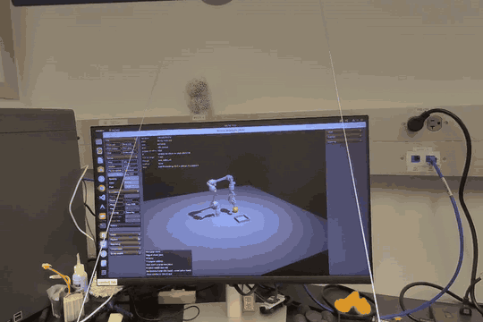
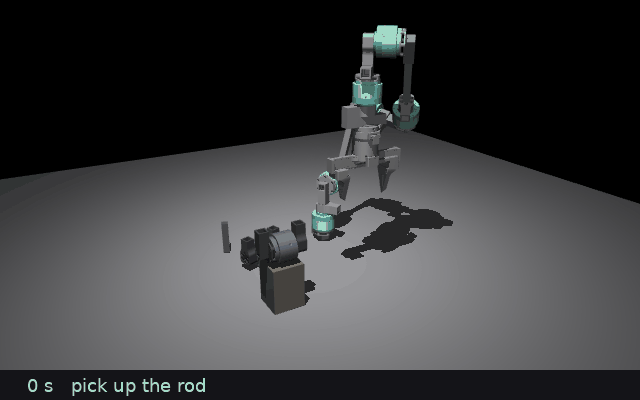
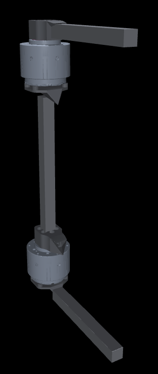
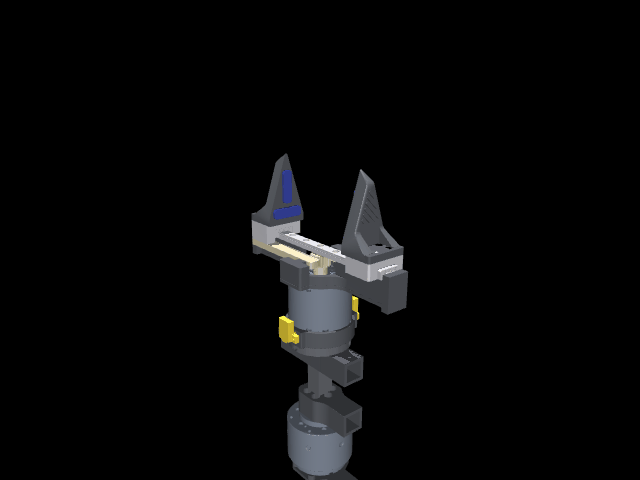

# Headset teleoperation and module assembly (simulation)

A PICO 4 Ultra headset drives the simulated arm through
[XRoboToolkit](https://github.com/XR-Robotics): hold the controller's grip and the
gripper follows the hand, the trigger closes the jaws. The arm's own inverse kinematics
keeps the grasp point on the target and turns the gripper as near the hand's rotation as
the arm allows, and targets stay inside the arm's measured reach. The page covers what
has been built on top of that since the first demo:

- **Tasks** the operator is scored on, from a tennis ball to assembling two modules.
- **A module library from CAD:** the MG5010E joint module, its square stick and the
  gripper, as parts a robot builder snaps together.
- **The real gripper mirrored:** its board's moves logged and the simulation fitted.

All of it runs in simulation. The code is part of MetaMachine, the lab's robot
framework, which is not public yet; this repository keeps the record and the clips.

*Through the headset: the PICO controller drives the simulated arm on the monitor.*
[Full recording (52 s)](media/teleop_demo.mp4)

## Setup

- **Two arm designs:** v1, the arm in this repository, and v2, a small-module arm
  whose joints turn freely. v2 now carries the only joint stops it has, where its
  parts touch: the elbow at +115° folds the forearm into the base, the wrist at −87°
  folds the gripper into the elbow. The arm has no cable limits.
- **The Teleop app.** The teleop runs from a page in MetaMachine's browser dashboard,
  next to the robot builder and the trainer: it picks the headset or a simulated
  controller, the arm, the task and the IK mode, starts the session and shows the
  MuJoCo view in the page. The dashboard learns such apps from a project's
  declaration, so a project adds a page without touching the dashboard's code.
- **Gripper modes.** The trigger drives the jaws by position, by squeeze force, or, for
  v2, through a mirror of the real gripper board (below).

## Tasks

Every trial is timed and logged (grasps, drops, near misses, joint travel), so arm
designs, IK modes and operators can be compared on the same task. In order of
difficulty:

| Task | Object | Done when |
| --- | --- | --- |
| `tennis_ball` | 67 mm ball, 58 g | in the tray |
| `cube` | 40 mm cube at a random yaw | in the tray |
| `small_cube` | 25 mm cube | in a 70 mm tray |
| `bottle` | 30 × 100 mm bottle, standing | standing in the tray within 15°: carried level, set down and let go, not dropped; toppled, it has to be righted |
| `module_assembly` | two MG5010E modules and a 16 mm square rod | the rod pushed into the clamped module's socket, the loose module pushed onto the rod's free end |

## Module assembly

The step toward the robot that builds robots: the arm joins two of its own joint
modules with a rod, in teleoperation.

*The scripted trial, twice real time: rod picked up, turned along the socket, pushed
in; module B picked up, turned, pushed onto the rod. The captions are the task's own
phase reports.*

- **The scene.** Module A (the MG5010E module from the catalog, as the robot builder
  draws it) is clamped on its side on a 100 mm stand with its output socket along the
  table; an 80 mm square rod stands on its end and module B lies on its side, both to
  the right of A, clear of the lane the arm sweeps when it pushes the rod in.
- **Sockets that take a rod.** The modules' collision shapes have the socket cavities
  cut out, with a flared mouth, so a rod can enter and nothing passes through a wall.
  The gripper's fingers are solid against the modules too.
- **Magnets.** The real rod ends and socket bottoms carry magnets. The task does not
  model the pull: a rod end 1 mm past a socket's mouth, within 4 mm of its axis, its
  axis within 8° and its square twist within 15° of a quarter turn, snaps exactly home
  and stays. The trial is done when both ends are seated, and the result is written as
  a robot file the robot builder opens, with the twists the operator chose.
- **The status rows** show which seat is next, how far in or out the rod end is, how
  far off the socket's axis, and the axis and twist errors.

**The scripted trial.** A test drives the v2 arm through the whole assembly without a
headset, from random part positions. Six of nine random layouts assemble end to end;
the rod seats in all nine, and the three that fail do so on a large wrist turn with the
0.5 kg module held. Each failure on the way was a real problem, not a scripting one:

- The arm folds its elbow back behind its base to point the gripper along the socket,
  and the elbow rested on the table whenever the gripper was below about 110 mm: hence
  the stand under module A. Parts lying in that corridor stopped the wrist: hence the
  spawn sector.
- With v2's joints free through ±180°, one solve of a far pose can land in a branch
  that folds the arm over its base, and the joint-space move there jams the arm on
  itself or flings the held module. The trial now feeds teleop's own tracker a target
  every 10 ms, as the operator's hand does, so the arm keeps its configuration.
- A flat pad on the motor's cylinder is a single contact point in MuJoCo, so "held"
  flickered and the module pivoted in the jaws; multi-point convex collisions fix it.
- The shoulder sags 6° with the gripper out sideways, which points a held rod 6° down;
  the trial measures the sag and commands against it.

## A module library from CAD

MetaMachine keeps a catalog of modules that its robot builder snaps together by their
docks, and trains and deploys what comes out. The ArthroBot parts are now in it as
their real geometry, converted from the Onshape STEP exports by a tool that turns a
fastened assembly into a module: parts grouped into links, meshes decimated for the
browser, collision boxes and cylinders, mass properties from the parts' hulls at the
recorded masses, and the docks measured from rods seated in every socket of the CAD.

*Two catalog MG5010E modules joined by the square stick, as the builder assembles them.*

- **`mg5010e_joint`:** the LKMTECH MG5010E-i36 motor (13 N·m rated, 1:36, 460 g) with
  its holder and output connector, four 16 mm square sockets: axial and side on the
  output, axial and side on the housing.
- **`square_stick_16`:** the 16 mm square carbon tube, its length a parameter of each
  robot.
- **One shared interface.** The sockets are female docks on the catalog's existing
  interface, so Lego rods, RS03 parts and wheels connect to them in the builder as to
  any other motor, and the square stick fits every other dock.

### The gripper module

*The gripper module (`gripper_b601`) closing and opening on a motor module, driven by
its one pinion motor; the module below turns it.*

The real gripper has one motor: the DM4310 turns a pinion that drives two racks, one
jaw each, in opposite directions. The module schema could only say "a joint has its own
motor, or it is free", which would have made the gripper either two motors, with every
trained policy producing two gripper actions the hardware does not have, or one motor
with jaws that never move. So the schema gained a **coupling**: a joint may follow
another joint of the same module at a fixed ratio, as a URDF mimic joint. The gripper's
jaws follow the pinion at its 8 mm pitch radius; the pinion is the one actuator, the
racks stay symmetric, and the action vector has one gripper channel, like the board.
The coupling is a constraint in the MuJoCo export, moves the jaws in the browser
preview, and leaves every existing module file unchanged.

The module carries three sockets on its holder, one axial in the bottom face as the
mount and one in each end face, so it mounts on any motor's output through a stick.

## The real gripper mirrored

The gripper's board (the reBot B601 DM gripper, a DM-J4310 motor) was driven through
its open and close moves and the motor's angle and torque logged at 100 Hz. The
simulated gripper for v2 was then fitted to those ten moves and runs the board's own
rules: its speed presets (0.5, 1.0 and 1.5 rad/s, 4 to 12 mm/s per jaw), its closed
target 2.6 mm short of the jaws touching, and its stall and speed trips.

| Fitted | Value |
| --- | --- |
| Coulomb friction on each jaw, at the motor | 0.136 N·m (the logs read 0.10 to 0.17 N·m moving, 0.33 N·m breakaway) |
| Position drive seen from the output | 15 N·m/rad stiffness, 2.5 N·m·s/rad damping: a finished move holds the friction 5 mrad from its target, a moving one trails by about 0.17 s times its speed |
| Fit over the ten moves | 3.7 mrad RMS jaw angle, 0.030 N·m RMS torque |

The motor's inertia register made the fit worse and is left out. This is the first
contact with the real hardware; the arms themselves have not run yet.

## Not done yet

- Teleoperation of robots assembled in the robot builder: the headset still drives the
  arm from its own CAD export, not from a catalog robot.
- The Isaac Lab integration does not read the coupling yet, so a catalog robot with the
  gripper trains in MuJoCo only.
- Magnet forces, if the pull-off behaviour of a seated rod ever matters.
- The remaining assembly-trial failures on large wrist turns with a module held.
